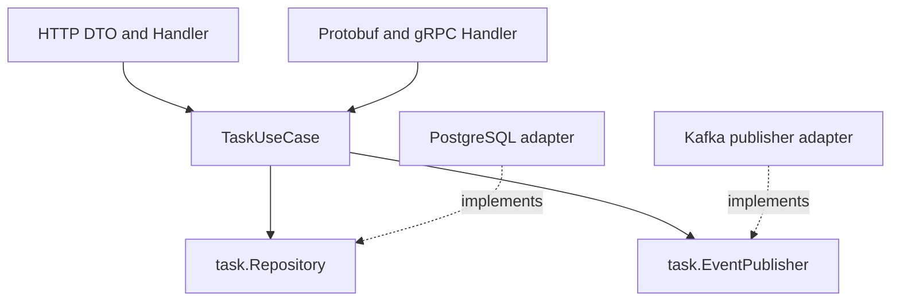
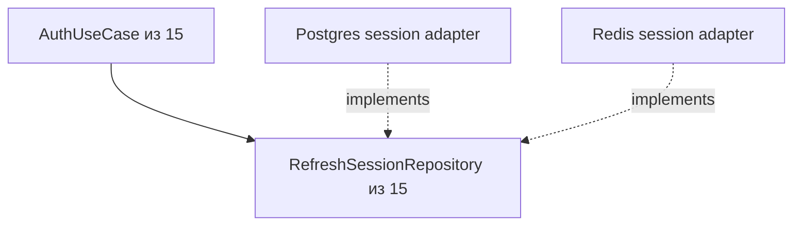
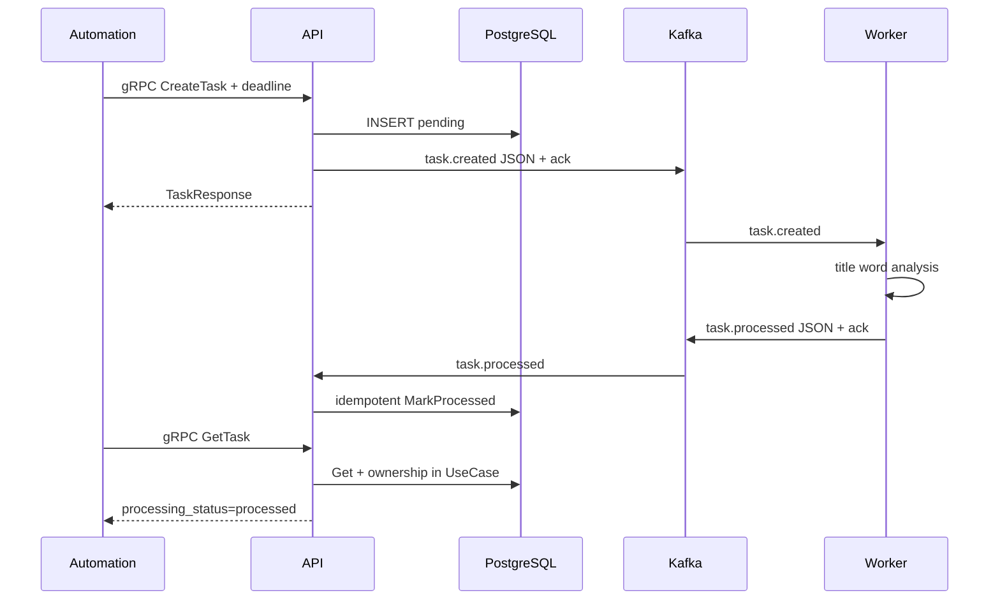

# Архитектура занятия 18

Application packages `internal/task`, `internal/user`, `internal/worker` знают только
Go types и interfaces. Они не импортируют pgx, Redis/Kafka clients, protobuf или net/http.
HTTP adapters остались из занятия 15; второй transport adapter — `internal/grpcapi`.

Пунктирные стрелки направлены от concrete adapter к application port, который он реализует.
Composition root передаёт implementation потребителю. Application не импортирует adapter.

AuthUseCase и интерфейс byte-for-byte прежние после замены module import prefix.
Новая технология не меняет смысл Login/Refresh/Logout.

Три процесса имеют разные подключения:

| Процесс | Слушает | Обращается |
| --- | --- | --- |
| api-service | HTTP 8080, gRPC 50051 | PG users/tasks, Redis sessions, Kafka created/results |
| task-worker | Не имеет внешнего API | Kafka, через Publisher port |
| automation-service | Local demo HTTP 8090 | Только gRPC API сервиса |

Worker считает слова title и формирует success/result event. Он не импортирует pgx и
не получает DATABASE_URL. API application ProcessedHandler проверяет event и owner,
затем вызывает ProcessingRepository.MarkProcessed. Это внутренний доверенный event,
не пользовательский PATCH. Done и ownership CRUD не меняются.

Kafka consumers commit только после handler success. Повтор output разрешён,
processed update идемпотентен. Ошибки SQL/publish повторяются с backoff. Некорректный
JSON/version/application event логируется без payload и пропускается; production
вариант добавит DLQ и наблюдаемость. DLQ не маскируется обещанием exactly once.

Каждый cmd — composition root своего процесса. В api wiring сосредоточены PG pool,
Redis client, Kafka publisher/consumer, UseCases, HTTP/gRPC handlers. Dockerfile
собирает каждый cmd в отдельный runtime image через SERVICE build arg.

Один image можно запустить несколькими containers. Compose service — декларация
процесса, container — конкретный instance. В учебном compose один API; при scale
нужно решить публикацию портов, readiness, business concurrency и service identity.
